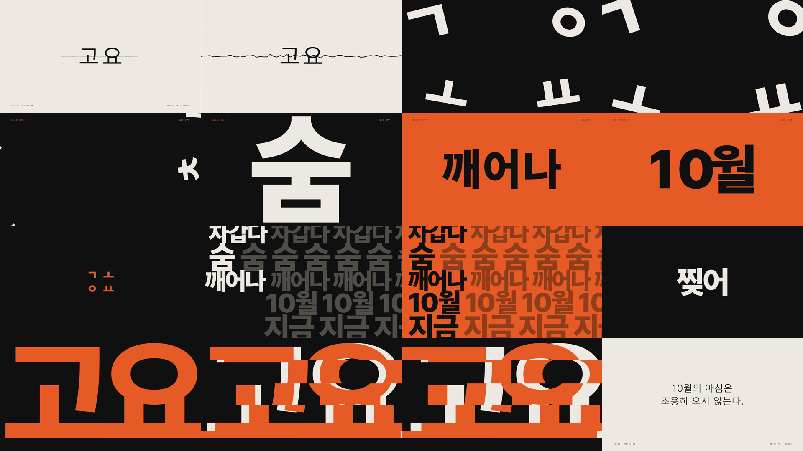

# 10월 아침, 고요를 찢다

30초 키네틱 타이포그래피 모션 그래픽(1920×1080, 30fps). HTML로 영상을 만드는 [HyperFrames](https://github.com/heygen-com/hyperframes)로 제작했다.

- 완성본: [`renders/october-tear.mp4`](renders/october-tear.mp4)
- 메시지: "10월의 아침은 조용히 오지 않는다."



## 구성

| 구간 | 화면 | 소리 |
|---|---|---|
| 0~4.9초, 고요 | 크림 바탕 가운데 가는 서체 "고요". 초침마다 시계 숫자가 넘어가고 단어가 점점 굵어지며 금이 간다 | 먼 새소리, 초침, 라이저 |
| 4.9~6.2초, 찢김 | 화면이 찢기고 검정으로 반전, "고요"가 자모 ㄱ ㅗ ㅇ ㅛ로 흩어진다 | 종이 찢는 소리와 첫 킥 |
| 6.2~15.5초, 질주 | 흩어진 자모가 마디마다 새 단어로 조립된다: 차갑다 / 숨 / 깨어나 / 10월 / 지금 | 136bpm 하드 테크노 |
| 15.5~26.7초, 정점 | 자모 귀환, 단어 더미, 플립북, 다시 찢기는 거대한 "고요" | 하이햇 롤, 최고 밀도 |
| 26.7~30초, 정적 | 크림 바탕으로 하드 컷, 마지막 한 줄 | 음악 끊김, 초침 한 번 |

## 파일

| 파일 | 역할 |
|---|---|
| `BRIEF.md` | 기획 의도, 선택한 콘셉트, 음악 조건과 금지 목록 |
| `STORYBOARD.md` | 프레임별 설계(구간, 박 위치, 문구, 모션). 이 문서가 제작 지시서다 |
| `frame.md` | 브랜드 프리셋(Broadside: 잉크 블랙, 불꽃 주황, 크림) |
| `audiomap.json` | 사운드트랙 박자 분석 결과. 모든 컷 타이밍의 기준 |
| `compositions/frames/*.html` | 프레임 5개. 각각 독립된 GSAP 타임라인 |
| `index.html` | 프레임과 사운드트랙을 이어 붙인 최종 컴포지션 |
| `scripts/build-bgm.sh` | 사운드트랙 미스 스크립트(아래 참고) |

## 다시 렌더하기

```bash
npm run check
npm run render
```

`package.json`이 HyperFrames 0.8.114를 고정한다. 렌더에는 Node.js와 FFmpeg가 필요하다.

## 사운드트랙

`assets/bgm.mp3`는 완성된 30초 믹스다. `scripts/build-bgm.sh`는 이 믹스를 만든 과정을 기록한 것이고, 원본 음원은 저장소에 넣지 않았다.

- 음악: HeyGen 음원 카탈로그 "dark aggressive hard techno, industrial rave"(136bpm) 원곡 17.16초~38.46초(12마디)를 영상 5.29초에 배치, -14 LUFS
- 효과음: HeyGen 효과음 라이브러리(새소리, 시계 초침, 라이저, 종이 찢기, 서브 임팩트)

## 폰트

한글은 [Pretendard](https://github.com/orioncactus/pretendard)(SIL Open Font License 1.1)를 이 영상에 쓰인 148자만 남긴 가변 서브셋(`assets/fonts/Pretendard-subset.woff2`, 45KB)으로 쓴다. 문구를 바꾸면 서브셋을 다시 만들어야 한다. 라벨은 IBM Plex Mono.
